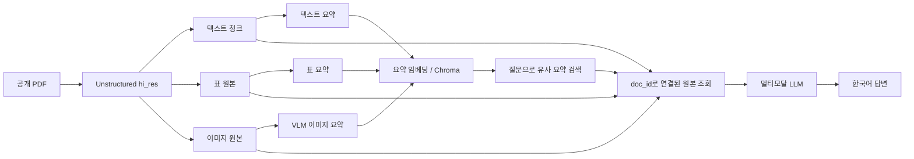

# PDF 멀티모달 RAG

PDF의 본문뿐 아니라 표와 그래프 이미지까지 검색·답변 근거로 사용하는 학습용 프로젝트입니다. 요약은 검색 색인으로 활용하고, 답변 생성에는 연결된 원본 텍스트·표·이미지를 전달합니다.

> **실행 전 필요 항목:** 이 저장소에는 과제용 PDF와 OpenAI API 키가 포함되어 있지 않습니다. 공개 PDF를 직접 `data/`에 추가하고 `.env`를 설정해야 요약/임베딩/답변 셀을 실행할 수 있습니다. 실행하지 않은 결과를 미리 만들어 넣지 않았습니다.

## 아키텍처



요약은 이미지까지 포함한 여러 종류의 자료를 텍스트 임베딩 검색 대상으로 만들기 위한 색인입니다. 요약만 답변 모델에 넣으면 수치·레이아웃 같은 세부사항이 사라질 수 있으므로, 같은 `doc_id`로 연결한 원본을 답변 모델에 전달합니다.

## 프로젝트 구조

```text
.
├── .env.example
├── .gitignore
├── requirements.lock.txt
├── data/
│   └── README.md
├── notebooks/
│   └── Multi_modal_RAG.ipynb
├── requirements.txt
└── src/
    └── multimodal_rag/
        ├── __init__.py
        ├── extract.py
        ├── pipeline.py
        ├── retriever.py
        └── summarize.py
```

## 설치 (Windows PowerShell)

Python 3.11 또는 3.12를 권장합니다. Poppler와 Tesseract는 pip 패키지가 아니므로 OS에 별도 설치하고 PATH에서 실행 가능한지 확인하세요.

```powershell
python -m venv .venv
.\.venv\Scripts\Activate.ps1
python -m pip install --upgrade pip
python -m pip install -r requirements.txt
python -m ipykernel install --user --name multimodal-rag --display-name "Python (multimodal-rag)"
Copy-Item .env.example .env
```

`.env`에 본인 키를 입력합니다.

```dotenv
OPENAI_API_KEY=your-key-here
```

PowerShell이 가상환경 스크립트 실행을 차단한다면 현재 사용자 범위에 한해 `Set-ExecutionPolicy -Scope CurrentUser RemoteSigned`를 설정할 수 있습니다. Poppler는 `pdftoppm -h`, Tesseract는 `tesseract -v`로 확인합니다.

## 데이터 준비 및 실행

1. 텍스트와 표/그래프를 포함한 공개 10~30페이지 PDF를 선정합니다. 수업 자료를 그대로 사용하지 마세요.
2. PDF를 `data/`에 넣습니다. PDF와 추출 이미지 폴더는 `.gitignore` 처리됩니다.
3. VS Code에서 `notebooks/Multi_modal_RAG.ipynb`를 열고 `Python (multimodal-rag)` 커널을 선택합니다.
4. 첫 셀의 `PDF_PATH` 값을 실제 PDF 파일명으로 바꾸고 위에서 아래로 실행합니다.
5. 질의응답 셀의 질문을 자료에 맞게 다듬고, 모든 답변의 수치와 근거를 원문에서 검증합니다.
6. 실제 실행 결과를 노트북에 저장하고 README의 비교·질의응답 표를 작성합니다.

`src/multimodal_rag/extract.py`는 `hi_res` 파싱 및 토큰 기반 분할, `summarize.py`는 텍스트·표·이미지 요약, `retriever.py`는 요약/원본 ID 연결, `pipeline.py`는 검색 원본을 이용한 멀티모달 답변을 제공합니다.

선택적으로 로컬 Ollama 서버에 `llama3.1:8b` 모델을 준비하면 노트북의 번역 체인을 실행할 수 있습니다. 기본 답변은 한국어로 작성되므로 이 단계는 필요할 때만 사용하세요.

노트북은 매 실행마다 새 Chroma 컬렉션과 이미지 출력 폴더를 사용합니다. 원본 문서는 메모리 저장소이므로 커널을 재시작하면 PDF 파싱, 요약, 색인 셀을 다시 실행해야 합니다. 이미지 요약과 임베딩/답변에는 API 비용이 발생할 수 있습니다. `create_retriever()`는 별도의 `persist_directory`도 지원하지만, 현재 메모리 원본 저장소와 함께 사용할 때는 색인과 원본 매핑을 같은 세션에서 다시 구성해야 합니다.

## 텍스트 RAG와 멀티모달 RAG 비교

아래 표는 실습 노트북의 같은 질문으로 두 결과를 생성한 뒤, 원본과 대조해 작성하세요. 빈 결과는 실행 전 템플릿이며 실험 결과를 의미하지 않습니다.

| 질문 | 텍스트 요약 기반 답변 | 원본 이미지/표 포함 답변 | 확인한 차이 |
|---|---|---|---|
| (실행 후 기입) | (실행 후 기입) | (실행 후 기입) | (원문 검증 후 기입) |

## 질의응답 및 근거 (5건)

노트북 마지막 질의응답 셀을 실행하고 답변과 원문 근거를 확인한 후 작성하세요.

| # | 질문 | 검증된 답변 | 근거 원본 종류 (텍스트/표/이미지) |
|---|---|---|---|
| 1 | (실행 후 기입) | (실행 후 기입) | (실행 후 기입) |
| 2 | (실행 후 기입) | (실행 후 기입) | (실행 후 기입) |
| 3 | (실행 후 기입) | (실행 후 기입) | (실행 후 기입) |
| 4 | (실행 후 기입) | (실행 후 기입) | (실행 후 기입) |
| 5 | (실행 후 기입) | (실행 후 기입) | (실행 후 기입) |

## 주요 선택과 한계

- `hi_res`는 레이아웃 분석을 통해 표/이미지 파싱을 개선하지만 처리 시간이 길고 Poppler 등 시스템 의존성이 필요합니다.
- `gpt-4o-mini`는 텍스트 요약과 이미지 이해에 사용합니다. `.env`에 키가 필요하며 입력 이미지/문서 길이에 따라 비용이 변합니다.
- 2,000 토큰 청크와 200 토큰 겹침을 기본값으로 사용합니다. PDF의 문단 구조와 질문 성능을 보고 조정하세요.
- 이미지 설명 및 OCR은 완벽하지 않을 수 있습니다. 특히 작은 글씨·복잡한 그래프의 수치는 원본 이미지와 대조해야 합니다.
- Chroma는 로컬 영속 저장소지만 원본 문서는 메모리 저장소이므로 현재 예제는 노트북 세션 간 원본 매핑을 유지하지 않습니다.

## 보안 및 의존성

`.env`, PDF, 추출 이미지, 벡터 DB는 저장소에서 제외합니다. `.env.example`은 필요한 환경변수 이름만 보여주며 실제 키를 넣지 마세요. 유출된 키는 즉시 폐기하고 재발급해야 합니다.

- `requirements.txt`: 사람이 검토·관리하는 상위 의존성 목록
- `requirements.lock.txt`: 현재 가상환경에서 생성한 설치 버전을 고정해 재현성을 보완하는 파일

설치 환경에서 잠금 파일을 만들려면 다음 명령을 실행하고 결과를 검토해 커밋하세요.

```powershell
python -m pip freeze > requirements.lock.txt
```
